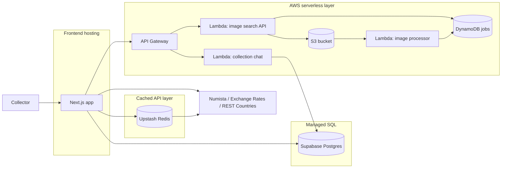

# Architecture

This project is designed around a simple principle: keep the app working quickly and cheaply, while staying flexible enough to evolve.

The overall strategy is:

- use managed services with generous free tiers where possible
- keep AWS mostly serverless to minimize fixed costs
- prefer simpler, more operationally lightweight solutions over highly customized infrastructure
- delay more expensive or more complex architecture changes until they are actually needed

## High-level architecture

## Architectural decisions and cost-first principles

The system is intentionally built around cost-sensitive choices:

- Supabase is the main database layer because it offers free Postgres databases and a very quick path to a working production-ready SQL setup.
- Vercel is used for the frontend because it is the easiest way to deploy and operate a Next.js app quickly and reliably.
- AWS is used mainly for serverless products (Lambda, API Gateway, S3, DynamoDB) so the project avoids large fixed infrastructure costs.
- Upstash Redis is used because it has a free tier and is a pragmatic cache for expensive third-party API calls.
- Terraform is used to unify deployment and infrastructure management across providers.

The key trade-off is that this architecture prioritizes speed, simplicity, and lowest cost early, not maximum performance at all costs. This is a deliberate choice for a personal project that does not have a large user base but still needs to stay available and reliable.

## 1) Frontend: Vercel + Next.js

### Role
The frontend is the user-facing app where collectors browse their notes, manage inventory, view analytics, and trigger image search or AI collection features.

### Why this technology was chosen

- Next.js was chosen because it was already the easiest way to build a polished UI quickly, especially at the start when a working product mattered more than perfect infrastructure decisions.
- Vercel was selected because it is the simplest and lowest-friction way to deploy a Next.js app.
- This allowed the project to reach a usable state quickly without spending time on custom hosting and CI/CD plumbing.

### Known cons

- The app embeds some API route logic, which makes a future migration to a different hosting model slightly more cumbersome.
- Vercel is convenient, but it is not the cheapest possible hosting option in the long term for a very large or highly customized deployment.

### Planned changes

- The long-term plan is to move the frontend to S3 + CloudFront to reduce hosting costs.
- This will require extracting the API routes currently embedded in the Next app so the frontend can become a static/deliverable asset layer instead of a server-rendering app at the edge.

## 2) Main database: Supabase Postgres

### Role
Supabase is the system of record for user data, collection items, country and currency metadata, and the authorization model around private collection data.

### Why this technology was chosen

- The main reason is cost: Supabase offers free-tier Postgres databases, which is a strong fit for both development and production usage in a small project.
- There are two free databases used for DEV and PROD environments.
- Postgres is well suited to the data model: collections, metadata, ownership, and relational links are a natural fit for SQL.
- The project already had a previous version built around a SQL database, so migrating the data was straightforward.

### Known cons

- Supabase is a managed service, so some infrastructure flexibility is reduced compared to self-hosting or using a raw AWS database service.
- This architecture intentionally avoids AWS SQL options because they do not offer a reasonable free-tier path comparable to Supabase for the current stage of the project.

### Planned changes

- No major database migration is planned at the moment.
- If the application grows significantly, the database may eventually need more careful performance tuning and operational review, but the current model remains a good fit for the project’s scale.

## 3) Cache layer: Upstash Redis

### Role
The Redis layer is used as a cache for third-party API results so repeated calls are avoided, which reduces external API cost and latency.

### Why this technology was chosen

- Upstash Redis has a free tier, which matches the project’s cost-first strategy.
- Redis is useful here because many API responses are repeated across users and requests.
- The cache is especially valuable for Numista, exchange-rate, and country-data lookups, because it helps avoid hitting API quotas too quickly when repeated requests would otherwise consume the limited monthly or daily allowance.

### Known cons

- Upstash offers a single free database, which is why DEV and PROD share the same Redis instance.
- This is acceptable because the cached data is not critical business data; it is mostly request deduplication and short-lived API response caching.
- Redis is a fast cache, but the project does not require true in-memory latency for every workload, so this layer is not overly critical from a business standpoint.

### Planned changes

- The project has a known future direction of replacing this cache with DynamoDB for better cost alignment and storage semantics.
- The reason is that the project does not strictly need the speed advantages of in-memory Redis for a read-through cache of mostly lightweight API responses.
- DynamoDB would also be easier to align with a more AWS-native serverless architecture.

## 4) AWS layer: serverless-first application infrastructure

### Role
AWS hosts the serverless API and processing parts of the app: the public HTTP layer, LLM-powered collection assistant, image search API, and the asynchronous OCR / AI processing pipeline.

### Why this technology was chosen

- The project uses serverless for almost everything in AWS to keep fixed costs as low as possible.
- Lambda, API Gateway, S3, and DynamoDB allow workloads to scale without paying for always-on compute.
- This is a good fit for an app with irregular demand and a need to keep costs predictable.

### Known cons

- Serverless adds more operational indirection than a single VM or traditional service cluster.
- Event-driven systems can be harder to debug than a simpler monolithic application.
- Some features require multiple small services and more configuration compared to hosting everything in one runtime.

### Planned changes

- Keep the architecture serverless-first unless the workload grows enough to justify a different model.
- Continue to favor simple, small, decoupled services over broader platform building.

## 5) AWS Lambdas: collection chat and image processing

### Role
The Lambda functions power the AI collection assistant and the image-search workflow.

### Why this technology was chosen

- Lambdas are used because they fit the serverless cost model and do not require paying for a constantly running backend.
- The JavaScript/TypeScript Lambdas keep the project simple by using one language across the main API surfaces.
- The image-processor Lambda is in Python because the project may later add image-processing steps such as resizing, cropping, or splitting multi-note images before AI analysis. That workflow is more natural in Python with common image-processing libraries.

### Known cons

- JavaScript lambdas are simple, but they are not the best choice for every heavy-processing workload.
- Python is better for image manipulation, but it creates a little more language diversity in the stack.
- Lambda cold starts can affect response time when traffic is low.

### Planned changes

- Keep JavaScript for the main service APIs unless a specific use case clearly benefits from another runtime.
- Continue exploring Python-based preprocessing in the image pipeline as the feature set grows.

## 6) Terraform and Terraform Cloud

### Role
Terraform centralizes infrastructure setup for Vercel, Supabase, Upstash, and AWS resources.

### Why this technology was chosen

- It keeps deployments and infrastructure changes in one language and one workflow.
- Terraform Cloud was chosen because it integrates cleanly with Terraform and makes state management straightforward.
- This reduces the chance of drift and keeps the deployment model consistent across environments.

### Known cons

- Infrastructure as code can be harder to debug when config changes are not applied in the intended order.
- Dependency on Terraform Cloud introduces a managed platform dependency, even though that is a practical choice for a small team.

### Planned changes

- Keep Terraform as the single source of truth for platform resources.
- If the infrastructure becomes more complex, the project may eventually need more explicit modularization and environment governance, but the current setup is already a good fit for the project size.

## 7) Why SQL instead of NoSQL

### Role
The main data store is relational SQL because the app’s data is structured and linked: users, banknotes, countries, currencies, grades, ownership, and metadata.

### Why this technology was chosen

- SQL maps well to the data model and makes it easier to maintain relationships and constraints.
- The project had a previous version based on SQL, so migration effort was reduced.
- Transactions, validation, and filtering are easier to reason about in a relational model for this kind of collection application.

### Known cons

- SQL is less flexible than document-oriented NoSQL when the model is very dynamic or fast-changing.
- Some analytics use cases can be easier to implement with document stores, but that is not the primary need here.

### Planned changes

- No major shift away from SQL is expected in the near term.
- If the app grows into a much more analytics-heavy, semi-structured product, some derived data or cache-backed read models may be introduced, but the base database is likely to remain relational.

## 8) CI/CD and database backups

### Role
GitHub Actions automates infrastructure deployment, Lambda checks and builds, Supabase migrations, and production database backups. Terraform Cloud stores Terraform state for the shared, dev, prod, and bootstrap workspaces.

### Why this technology was chosen

- GitHub Actions integrates directly with the repository, so changes can be deployed from the existing development and production branches without a separate CI platform.
- Terraform centralizes infrastructure deployment across providers; Terraform Cloud provides managed state and locking with minimal setup.
- The backup workflow uses Supabase CLI to export database roles, schemas, and data, then uploads the files to an AWS S3 bucket.
- GitHub Actions accesses AWS through OIDC and an IAM role rather than long-lived AWS credentials.

### How it works

- Pushes to `dev` or `main` that change infrastructure, Lambda, Supabase, frontend, or deployment workflow files run the deployment workflow; it can also be started manually.
- Deployment applies the shared Terraform root, then the matching dev or prod root. It builds and checks the Lambda APIs, pushes Supabase migrations, and seeds the dev database only.
- The production backup workflow runs daily at 02:00 UTC or on demand. It stores role, schema, and data dumps in S3, where the bucket lifecycle expires backups after 30 days.

### Known cons

- Deployment depends on correctly configured GitHub Actions secrets and variables, Terraform Cloud workspaces, and cloud-provider permissions.
- Backups are SQL dump files in S3; restoring them requires the appropriate database access and restore procedure.
- Automated backups reduce recovery risk but do not replace testing restores or maintaining migrations.

### Planned changes

- No specific CI/CD or backup redesign is currently planned. Keep deployment and backup workflows aligned with infrastructure changes, and verify restore procedures when the database or backup format changes.

## Summary

The architecture is intentionally optimized for low cost and fast delivery, not for maximum theoretical performance or the most advanced cloud-native pattern. Managed services, serverless infrastructure, and free-tier-friendly choices keep the project practical and easy to operate.

The most important long-term trade-off is that some current choices are temporary. The frontend may move from Vercel to S3 + CloudFront, the cache may move from Upstash Redis to DynamoDB, and the deployment model may evolve as the product grows. But for now, the stack is designed to get the app working quickly and cheaply with minimal operational overhead.
