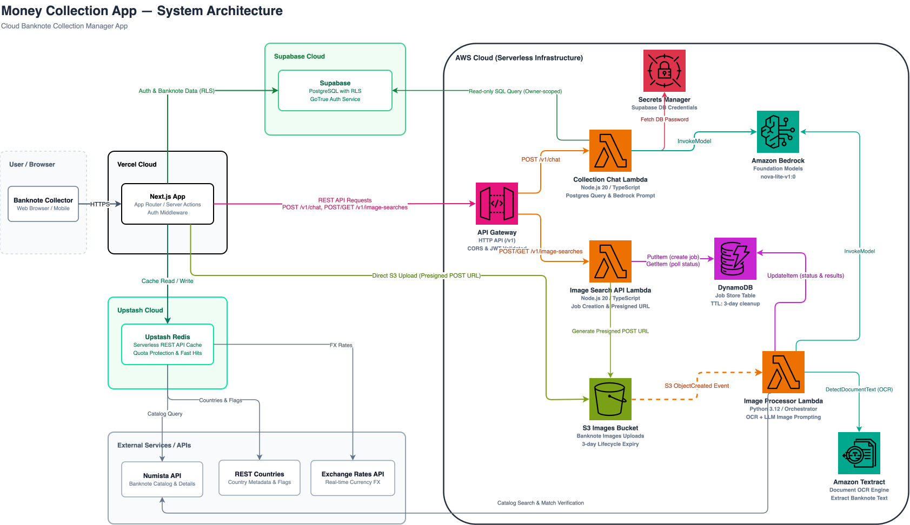
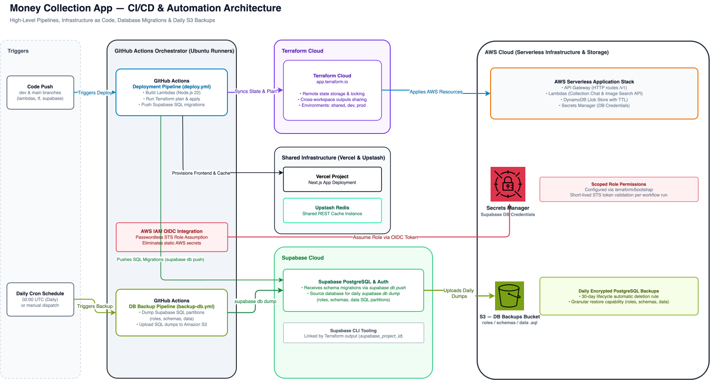

# Architecture

This project is designed around a simple principle: keep the app working quickly and cheaply, while staying flexible enough to evolve.

The overall strategy is:

- use managed services with generous free tiers where possible
- keep AWS mostly serverless to minimize fixed costs
- prefer simpler, more operationally lightweight solutions over highly customized infrastructure
- delay more expensive or more complex architecture changes until they are actually needed

## High-level architecture

### System Architecture

### CI/CD & Automation Architecture

## Architectural decisions and cost-first principles

The system is intentionally built around cost-sensitive choices:

- Supabase is the main database layer because it offers free Postgres databases and a very quick path to a working production-ready SQL setup.
- Vercel is used for the frontend because it is the easiest way to deploy and operate a Next.js app quickly and reliably.
- AWS is used mainly for serverless services (Lambda, API Gateway, S3, DynamoDB) so the project avoids large fixed infrastructure costs.
- Upstash Redis is used because it has a free tier and is used as a cache to limit cost related to third-party API calls.
- Terraform is used to unify deployment and infrastructure management across providers.

The key trade-off is that this architecture prioritizes speed, simplicity, and lowest cost early, not maximum performance at all costs. Another downside is that deployement is spread across multiple providers, which may increase complexity in management and monitoring. This is a deliberate choice for a personal project that does not have a large user base but still needs to stay available and reliable at low cost.

## 1) Frontend: Vercel + Next.js

### Role
The frontend is the user-facing app where collectors browse their notes, manage inventory, view analytics, and trigger image search or AI collection features.

### Why this technology was chosen

- Next.js was chosen because it was an easy way to build a polished UI quickly and it has a strong ecosystem of components and libraries.
- Vercel was selected because it is the simplest and lowest-friction way to deploy a Next.js app.
- This allowed the project to reach a usable state quickly without spending time on custom hosting and CI/CD plumbing.

### Known cons

- The app embeds some API route logic, which makes a future migration to a different hosting model slightly more complex.
- Vercel is convenient, but it is not the cheapest possible hosting option in the long term for a very large or highly customized deployment.

### Planned changes

- The long-term plan is to move the frontend to S3 + CloudFront to reduce hosting costs.
- This will require extracting the API routes currently embedded in the Next app so the frontend can become a static/deliverable asset layer instead of a server-rendering app at the edge.

## 2) Main database: Supabase Postgres

### Role
Supabase is the system of record for user data, collection items, country and currency information, and the authorization model around private collection data.

### Why this technology was chosen

- The main reason is cost and ease of use: Supabase offers free-tier Postgres databases, which is a strong fit for both development and production usage in a small project.
- There are two free databases used for DEV and PROD environments.
- Supabase provides a simple way to manage authentication as well as database migrations and schema changes, which is important for a project that is still evolving.
- Postgres is well suited to the data model: collections, metadata, ownership, and relational links are a natural fit for SQL.
- The project already had a previous version built around a SQL database, so migrating the data was straightforward.
- This architecture intentionally avoids AWS RDS because it does not offer a reasonable free-tier path comparable to Supabase for the current stage of the project.

### Known cons

- Supabase is a managed service, so some infrastructure flexibility is reduced compared to self-hosting or using a raw AWS database service.

### Planned changes

- No major database migration is planned at the moment.
- If the application was to grow significantly, the database may eventually need more careful performance tuning and operational review, but the current model remains a good fit for the project’s scale.

## 3) Cache layer: Upstash Redis

### Role
The Redis layer is used as a cache for third-party API results so repeated calls are avoided, which reduces external API cost and latency.

### Why this technology was chosen

- The main reason for the cache is for Numista, exchange-rate, and country-data lookups, because it helps avoid hitting API quotas too quickly when repeated requests would otherwise consume the limited monthly or daily allowance.
- Upstash Redis has a free tier, which matches the project’s cost-first strategy.
- Redis is useful here because many API responses are repeated across users and requests.

### Known cons

- Upstash offers a single free database, which is why DEV and PROD share the same Redis instance.
   - For now, this is acceptable because the cached data is not critical business data. It is mostly request deduplication and short-lived API response caching. And data from environment-specific databases is not cached in Redis, so there is no risk of cross-environment data contamination.
- Redis is a fast cache, but the project does not require true in-memory latency for every workload, so this layer is not overly critical from a business standpoint.

### Planned changes

- It is planned to replace the Redis cache with using DynamoDB as API cache.
   - DynamoDB supports TTL and is a good fit for caching API responses, which are mostly lightweight JSON objects.
   - For our use case, in-memory cache is not necessary
   - DynamoDB would permit us to have two separate caches for DEV and PROD, which is a better long-term architecture.

## 4) AWS layer: serverless-first application infrastructure

### Role
AWS hosts the serverless API and processing parts of the app: 
- the public HTTP layer, 
- LLM-powered collection assistant, 
- image search API and the asynchronous OCR / AI image processing pipeline.

### Why this technology was chosen

- The project uses serverless for almost everything in AWS to keep fixed costs as low as possible.
- Lambda, API Gateway, S3, and DynamoDB allow workloads to scale without paying for always-on compute.
- This is a good cost-effective fit for an app with that needs to be available at all times but with low and irregular demand.

### Known cons

- A Serverless event-driven systems can be harder to debug than a simpler monolithic application.
- Some features require multiple small services and more configuration compared to hosting everything in one runtime.

### Planned changes

- Keep the architecture serverless-first unless the workload grows enough to justify a different model.
- Continue to favor simple, small, decoupled services over broader platform building.
- Integrate the API requests handled by the Next.js api routes into the AWS API Gateway and Lambda layer to reduce the number of different hosting models in use.

## 5) AWS Lambdas: collection chat and image processing

### Role
The Lambda functions power the AI collection assistant and the image-search workflow.

### Why this technology was chosen

- Lambdas are used because they fit the serverless cost model and do not require paying for a constantly running backend.
- The JavaScript/TypeScript Lambdas keep the project simple by using one language across the main API surfaces.
- The image-processor Lambda is in Python because the project may later add image-processing steps such as resizing, cropping, or splitting multi-note images before AI analysis. That workflow is more natural in Python with common image-processing libraries.

### Known cons

- JavaScript lambdas are simple, but they are not the best choice for every heavy-processing workload (which so far is not a problem for the current workloads).
- Python is better for image manipulation, but it creates a little more language diversity in the stack.
- Lambda cold starts can affect response time when traffic is low (not a concern for now).

### Planned changes

- Keep JavaScript for the main service APIs unless a specific use case clearly benefits from another runtime.

## 6) Terraform and Terraform Cloud

### Role
Terraform centralizes infrastructure setup for Vercel, Supabase, Upstash, and AWS resources.

### Why this technology was chosen

- It keeps deployments and infrastructure changes in one language and one workflow.
- Terraform Cloud was chosen because it integrates cleanly with Terraform and makes state management straightforward.
- This reduces the chance of drift and keeps the deployment model consistent across environments.

### Known cons

- Dependency on Terraform Cloud introduces a managed platform dependency.

### Planned changes

- No planned change. Terraform will be kept as the single source of truth for platform resources.

## 7) CI/CD and database backups

### Role
GitHub Actions automates infrastructure deployment, Lambda checks and builds, Supabase migrations, and production database backups. Terraform Cloud stores Terraform state for the shared, dev, prod, and bootstrap workspaces.

### Why this technology was chosen

- GitHub Actions integrates directly with the repository, so changes can be deployed from the existing development and production branches without a separate CI platform.
- Terraform centralizes infrastructure deployment across providers; Terraform Cloud provides managed state and locking with minimal setup.
- The backup workflow uses Supabase CLI to export database roles, schemas, and data, then uploads the files to an AWS S3 bucket.
- GitHub Actions accesses AWS through OIDC and an IAM role rather than long-lived AWS credentials.

### How it works

- Pushes to `dev` or `main` that change infrastructure, Lambda, Supabase, frontend, or deployment workflow files run the deployment workflow; it can also be started manually.
- Deployment applies the shared Terraform root, then the matching dev or prod root. It builds and checks the Lambda APIs, pushes Supabase migrations, and seeds the dev database only.
- The production backup workflow runs daily at 02:00 UTC or on demand. It stores role, schema, and data dumps in S3, where the bucket lifecycle expires backups after 30 days.

### Known cons

- Deployment depends on correctly configured GitHub Actions secrets and variables, Terraform Cloud workspaces, and cloud-provider permissions.
- Backups are SQL dump files in S3; restoring them requires the appropriate database access and restore procedure.
- Automated backups reduce recovery risk but do not replace testing restores or maintaining migrations.

### Planned changes

- No specific CI/CD or backup redesign is currently planned.

## Summary

The architecture is intentionally optimized for low cost and fast delivery, not for maximum theoretical performance or the most advanced cloud-native pattern. Managed services, serverless infrastructure, and free-tier-friendly choices keep the project practical and easy to operate.

The most important long-term trade-off is that some current choices are temporary. The frontend may move from Vercel to S3 + CloudFront, the cache may move from Upstash Redis to DynamoDB, and the deployment model may evolve as the product grows. But for now, the stack is designed to get the app working quickly and cheaply with minimal operational overhead.
